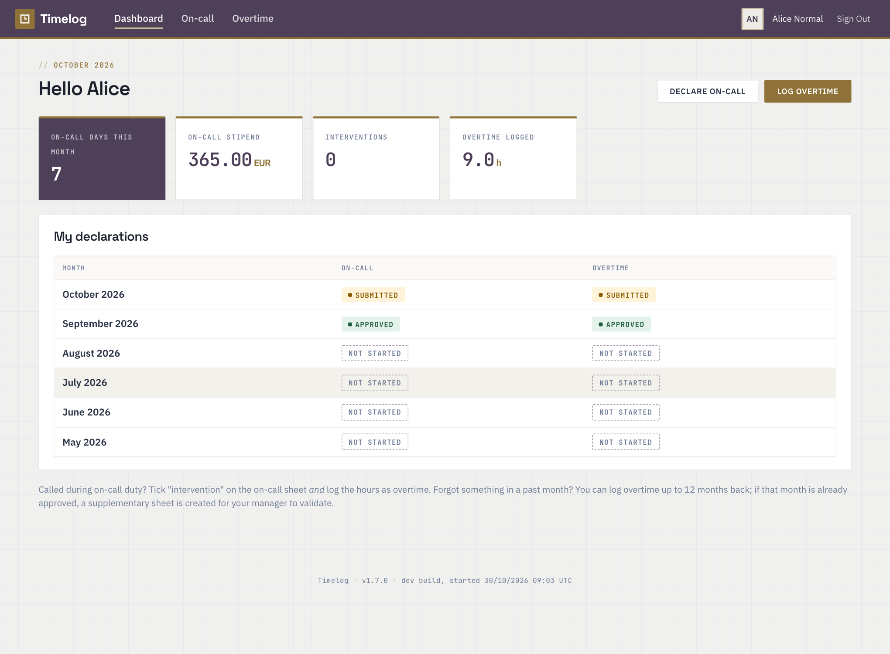
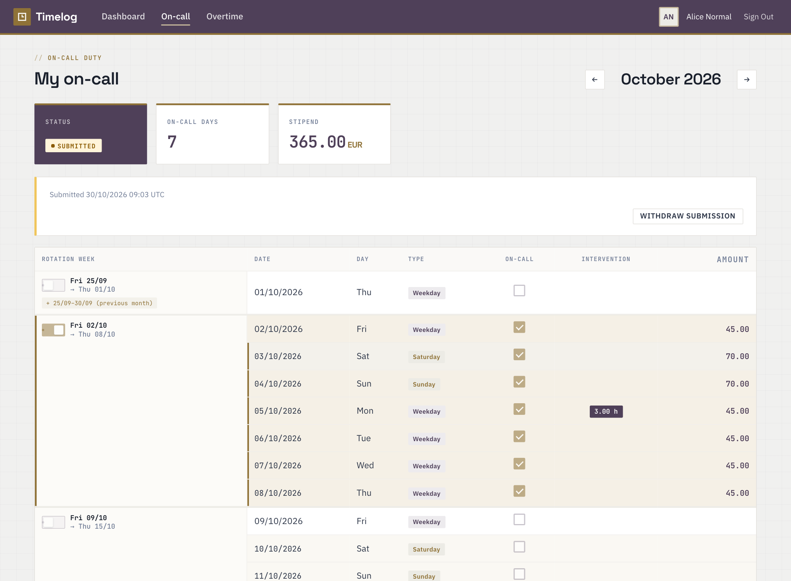
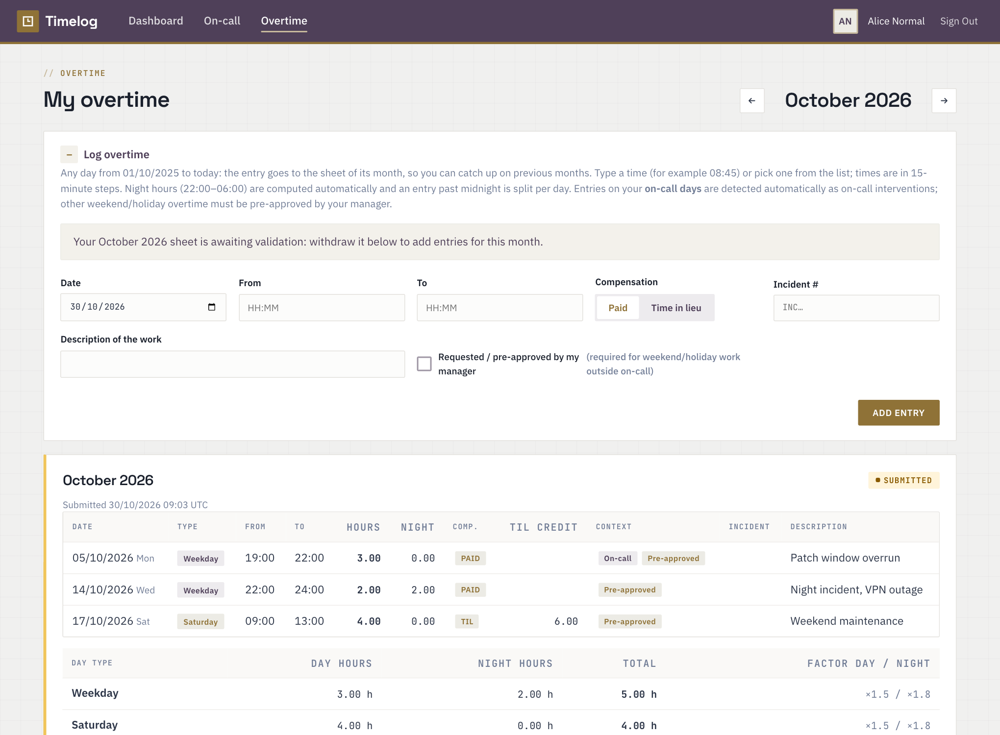
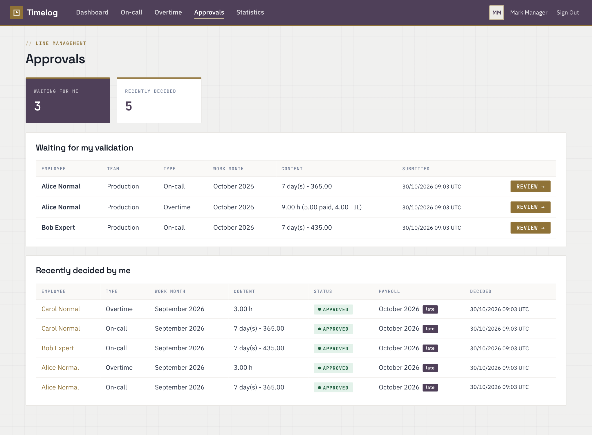
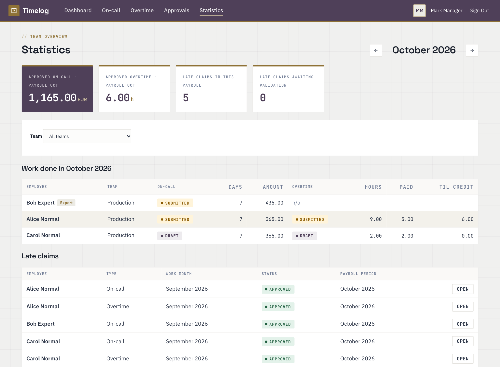
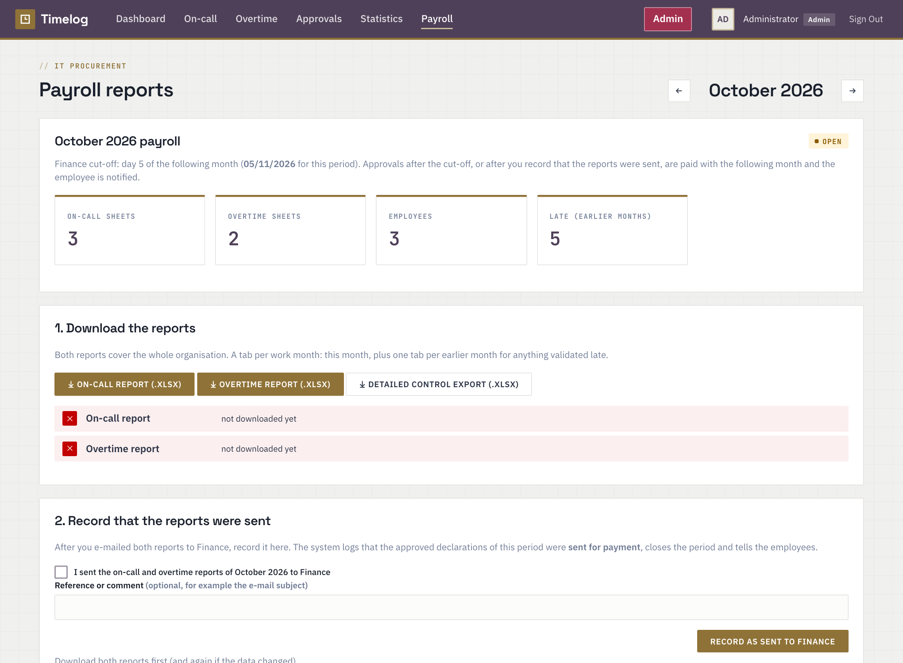

# TimeLog: on-call and overtime declarations

This web app handles on-call and overtime declarations, their validation and the monthly Finance export.
- **Employees** declare on-call days and overtime.
- **Line managers** validate them and export a monthly `.xlsx` for Finance.

Business rules and design decisions are in [CLAUDE.md](CLAUDE.md).

## Screenshots
Demo data (fictional users); the interface is the same in production.

| | |
|---|---|
| **Dashboard**: month status, on-call stipend, overtime logged | **On-call**: rotation weeks with a week switch, day types and rates |
|  |  |
| **Overtime**: 15-minute entries, day/night hours, paid or time in lieu | **Approvals**: line managers validate direct and skip-level reports |
|  |  |
| **Statistics**: team status, totals and late claims | **Payroll**: reports for Finance and the sent-to-Finance record |
|  |  |

## Stack
The app runs as three containers (Docker Compose). Only `proxy` publishes ports.

- `proxy`: nginx, which terminates HTTPS with your Microsoft PKI certificate.
- `app`: Python / FastAPI. It has no CDN or external resources and needs no internet at runtime.
- `db`: PostgreSQL 16 (folder `./db-data`).

## Installation

```bash
cp .env.example .env            # then edit: SERVER_NAME, SECRET_KEY, POSTGRES_PASSWORD, admin password
openssl rand -hex 32            # -> SECRET_KEY

# TLS certificate (choose one)
scripts/make-selfsigned.sh timelog.corp.example.lu      # temporary / dev
scripts/make-csr.sh timelog.corp.example.lu             # production: submit CSR to AD CS (see below)

scripts/build.sh                                         # builds timelog-app:<version> (version + build time in the footer)
docker compose up -d
# non-standard ports (e.g. HTTPS_PORT=8443): also set HTTPS_PORT_SUFFIX=:8443 so the HTTP->HTTPS redirect keeps the port
docker compose ps                                        # all services "healthy"
```

Open `https://<SERVER_NAME>` and sign in with `BOOTSTRAP_ADMIN_USERNAME` / `BOOTSTRAP_ADMIN_PASSWORD`.

Optional demo accounts for testing (`head`, `manager`, `alice`, `bob` (Expert), `carol`, `dave`):
```bash
docker compose exec app python -m timelog.demo            # prints a random password
docker compose exec app python -m timelog.demo '<password>' # or set one
```

## Offline (air-gapped) deployment

Timelog runs as Docker containers and is meant to be deployed on-premise **without internet access**. Two server targets
are supported:

| Target | How it runs | Installer |
|---|---|---|
| **Red Hat Enterprise Linux 9** (x86_64) | Docker Engine on RHEL, SELinux can stay enforcing | `install.sh` (can install Docker from RPMs shipped in the package) |
| **Windows Server 2022+** | **Linux containers** through Docker on WSL 2 (Docker Engine in WSL 2, or Docker Desktop). Windows-native containers are not supported | `install.ps1` (Docker must be installed beforehand) |

You build one **offline package** (a zip) per target on a machine with internet access and Docker, carry it to the server and
install it there. The server needs nothing else: no registry, no PyPI, no `openssl` (certificates are handled by a tool inside
the application image).

### 1. Build the package (connected machine)
Requirements: Docker (28+, with `buildx`), `zip`, `python3`, internet access (PyPI, Docker Hub, Docker's RPM repository), or your
internal mirrors (`PIP_INDEX_URL`, `PIP_TRUSTED_HOST`).
```bash
scripts/make-offline-package.sh                          # RHEL 9, x86_64  -> dist/timelog-<version>-offline-rhel9-amd64.zip
TARGET=windows scripts/make-offline-package.sh           # Windows Server  -> dist/timelog-<version>-offline-windows-amd64.zip
INCLUDE_DOCKER_RPMS=0 scripts/make-offline-package.sh    # RHEL, but the server already has Docker (smaller package)
PLATFORM=linux/arm64 scripts/make-offline-package.sh     # other CPU architecture (default linux/amd64)
```
A `.sha256` file is written next to each zip. The images are built for the **server's** CPU architecture, which can differ
from your build machine's (for example an Apple Silicon laptop building for x86_64; this goes through emulation and takes
longer); the script checks the architecture of every saved image and stops on a mismatch. Run the tests
(`cd app && .venv/bin/pytest`) before packaging a release.

| In the zip | Purpose |
|---|---|
| `images/timelog-images.tar.gz` | The three container images: application, nginx, PostgreSQL 16 |
| `docker-compose.yml`, `.env.example`, `proxy/` | Stack definition and configuration template |
| `install.sh` or `install.ps1` | Verifies the package, (RHEL) installs Docker, loads the images, generates `.env` with random secrets, creates a temporary certificate, opens the firewall, starts the stack. Also used for upgrades |
| `convert-pfx.sh` / `convert-pfx.ps1` | Turns the **PFX** issued by the PKI into the PEM files nginx needs (`certs/server.crt`, `certs/server.key`) |
| `docker-rpms/` (RHEL only) | Docker Engine, containerd and the Compose plugin as RPMs, for `install.sh --install-docker` |
| `certs/README.md`, `docs/` | Certificate file layout; this README, the design and business rules, the Python dependency list |
| `README-OFFLINE.md` | The deployment guide for the target OS (requirements, install, upgrade, troubleshooting) |
| `CHECKSUMS.sha256`, `MANIFEST.txt`, `VERSION` | Integrity checks and what the package contains (version, build time, commit, platform, target) |

### 2. Install (target server)
Copy the zip (and its `.sha256`) to the server, then:
```bash
# RHEL 9
unzip timelog-<version>-offline-rhel9-amd64.zip && cd timelog-<version>-offline-rhel9-amd64
sudo ./install.sh --server-name timelog.corp.example.lu --install-docker --open-firewall
```
```powershell
# Windows Server (elevated PowerShell)
Expand-Archive timelog-<version>-offline-windows-amd64.zip -DestinationPath C:\timelog
cd C:\timelog\timelog-<version>-offline-windows-amd64
powershell -ExecutionPolicy Bypass -File .\install.ps1 -ServerName timelog.corp.example.lu -OpenFirewall
```
The installer prints the first administrator password. Afterwards, in this order: install the PKI certificate
(`convert-pfx.sh` / `convert-pfx.ps1`, then `docker compose restart proxy`), configure LDAP in **Admin > Settings** (use *Test
connection*), schedule backups in **Admin > Backup**, and keep a protected copy of `.env` (`SECRET_KEY` and `BACKUP_PASSPHRASE`
are needed to read the LDAP password and the backups). Step-by-step guides, upgrade and troubleshooting are in
`README-OFFLINE.md` inside each package.

### 3. Upgrade
Build a new package, unzip it anywhere and run `sudo ./install.sh` again (RHEL; `install.ps1 -Upgrade` on Windows). The RHEL
installer puts the program in `/opt/timelog` (`--dir` to change it) and finds an existing installation by its `.env`: `.env`,
`certs/`, `db-data/` (PostgreSQL) and `backups/` stay in that directory and are kept, only the program files and images change.
The application creates new tables by itself at start-up. Take a backup first (Admin > Backup). To roll back, run the installer
from the previous package.

## HTTPS with a Microsoft PKI certificate
If the PKI gives you a **PFX** file, in an offline package use `convert-pfx.sh` / `convert-pfx.ps1` (it runs inside the application
image, no openssl needed); the manual `openssl` commands are in Admin > Documentation.
1. `scripts/make-csr.sh timelog.corp.example.lu [alias ...]` creates `certs/server.key` and `certs/server.csr`.
   The CSR has its SAN set, uses serverAuth and an RSA 3072 key.
2. On a domain-joined Windows host:
   `certreq -submit -attrib "CertificateTemplate:WebServer" server.csr server.cer`.
   You can also use the `/certsrv` web enrolment page.
3. Convert the certificate and build the chain, server certificate first:
   ```bash
   openssl x509 -inform DER -in server.cer -out server.pem     # if DER
   cat server.pem issuing-ca.pem > certs/server.crt
   ```
4. Run `docker compose restart proxy`. Clients trust the certificate through the domain's root CA (GPO).

nginx redirects HTTP to HTTPS, uses TLS 1.2 and 1.3, and sends HSTS. The app trusts `X-Forwarded-*` only from the proxy,
because the app port is not published. Session cookies are `Secure` and `HttpOnly`.

## LDAP / Active Directory
You can configure LDAP in the app under **Admin › Settings**, or in `.env`. Values saved in the UI override `.env`,
and "Reset to .env values" goes back to the file. In the UI:
- The bind password is stored encrypted and is never displayed back.
- You can paste the CA certificate as PEM.
- **Test connection** checks the bind and looks up a user, showing their groups and manager.

With `.env`, set the `LDAP_*` variables and `LDAP_ENABLED=true`. Then:
- Use a read-only **service account** (`LDAP_BIND_DN`) to search for users.
- Use LDAPS (`ldaps://dc:636`), or `ldap://` with `LDAP_START_TLS=true`.
- Export the PKI root CA as Base-64 into `certs/ldap-ca.pem` (the path inside the container is `/certs/ldap-ca.pem`).
- Groups (nested membership supported, AD only):
  - `LDAP_GROUP_REQUIRED` decides who may log in.
  - `LDAP_GROUP_ADMIN` grants administrators.
  - `LDAP_GROUP_EXPERT` marks Expert employees.

  If you leave one empty, you manage that flag manually under Admin › Users.
- The **line manager** is read from the AD `manager` attribute at each login. To override it, set it in
  Admin › Users and tick "Lock manager".

After LDAP works, set `LOCAL_LOGIN_ADMIN_ONLY=true`. This keeps only the local break-glass admin account.

## Using the app
| Role | What they can do |
|---|---|
| Employee | **On-call** grid per month: book a whole rotation week (Friday → Thursday) with the week switch, or tick individual days, then "intervention" and incident # / comment. **Overtime** entries: date, from/to typed or picked in 15-minute steps, PAID or TIL; the sheet shows hours by day type, split into day and night hours. Then *Submit for validation*. Overtime can be logged for previous months, up to 12 months back. If that month is already approved, a supplementary sheet (late claim) is created. |
| Signature | If the administrator enables it (Admin › Settings), employees draw a signature and confirm a statement when submitting; managers see it with an integrity check. |
| Employee (cont.) | When called during on-call duty, log the intervention (hours, incident #, description) on the **overtime** sheet only. Entries on on-call days are recognised automatically. |
| Expert | On-call only. An intervention doubles that day's on-call rate. No overtime. |
| Line manager | **Approvals**: approve, or reject with a comment, the sheets of direct reports and (skip-level) of everyone below them. **Statistics**: status and totals of everyone below them. |
| IT Procurement | **Payroll**: downloads the on-call and overtime reports of the whole organisation (work month + everything validated late), and **records that they were sent to Finance**. That closes the payroll period: anything approved afterwards is paid the following month and the employee is notified. Cannot see individual declarations. |
| Admin | Users (manager, grade, Expert/Admin flags, local accounts), grades and on-call rates, legal holidays (with `.ics` import), TIL factors, settings (e.g. hide on-call amounts from employees), audit log. Can reopen an approved sheet. |

Employees have a built-in **User Guide** (nav tab before Admin) explaining how to file on-call and overtime.

Colleagues never see each other's declarations. Managers see only the people below them in the hierarchy.

### Exports for Finance
Under **Payroll**, IT Procurement (and admins) download, for a **payroll period** and for the whole organisation:
- the **on-call sheet** `Y<yy>M<mm>_IT_OnCall.xlsx` and the **overtime sheet** `Y<yy>M<mm>_IT_Overtime.xlsx`, laid out like the
  sheets Finance works with (one tab per work month; late claims, approved after their cut-off, get their own tab "… (late)"),
  with the values computed by the application (no formulas);
- a **detailed control export** (`IT_OnCall_Overtime_YYYYMM.xlsx`): Summary (status of every person), On-Call, On-Call Grid,
  Overtime Payroll (hours by day type, night hours, HL100 / HL101 / HL111 / HL130 / HL121, TIL), and line-by-line detail tabs.

Sheets approved by the Finance cut-off (`PAYROLL_CUTOFF_DAY`, default **the 5th** of the following month, editable in Admin >
Settings) are paid with their work month; anything approved later, or after IT Procurement recorded the period as sent, goes
into the next open payroll period and is labelled "Late claim". Employees are notified when their payment moves.

## Operations
- Backup: **Admin › Backup** sets the schedule (daily or weekly, UTC) and creates, downloads, uploads and restores
  backups. They are **encrypted** (AES-256-GCM) with `BACKUP_PASSPHRASE`, or a key derived from `SECRET_KEY`, and kept in the
  `./backups` folder. Store the passphrase safely and copy the files off the host. `scripts/backup-db.sh` (native
  `pg_dump`, not encrypted) still works for cron.
- Logs: `docker compose logs -f app proxy`.
- Health: `GET /healthz`.
- Update: `scripts/build.sh` (or load the new image), then `docker compose up -d`. The footer of every page shows
  the version and build timestamp, which `/healthz` also returns.

## Development
```bash
cd app && python3 -m venv .venv && .venv/bin/pip install -r requirements.txt -r requirements-dev.txt
.venv/bin/pytest -q
DATABASE_URL=sqlite:///./dev.db SECRET_KEY=$(openssl rand -hex 32) SESSION_COOKIE_SECURE=false \
  BOOTSTRAP_ADMIN_USERNAME=admin BOOTSTRAP_ADMIN_PASSWORD='<choose-a-local-password>' \
  .venv/bin/uvicorn --factory timelog.main:create_app --reload
```
